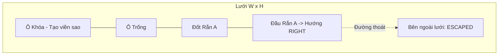
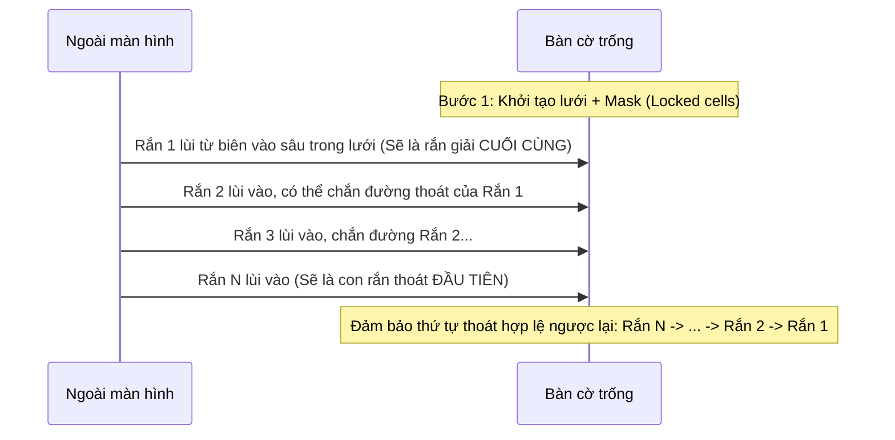
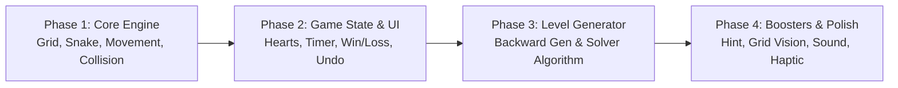

# TÀI LIỆU ĐẶC TẢ KỸ THUẬT & GAMEPLAY (GAME SPECIFICATION)
## DỰ ÁN: SNAKE ESCAPE (Tên tạm thời)

---

## 1. TỔNG QUAN DỰ ÁN (OVERVIEW)

### 1.1. Giới thiệu
**Snake Escape** là một tựa game casual logic puzzle kết hợp giữa cơ chế "Tap-Away / Unblock" và hình tượng loài rắn uốn lượn. Người chơi phải quan sát một bàn cờ nhiều hình dạng (vuông, chữ nhật, trái tim, ngôi sao...), chạm vào các con rắn để chúng trườn thẳng ra khỏi lưới mà không va chạm với các con rắn khác hoặc chướng ngại vật.

### 1.2. Mục tiêu cốt lõi (Core Game Loop)
1. **Quan sát & Phân tích:** Đánh giá thế trận, nhận diện con rắn nào có đường thoát tự do phía trước.
2. **Quyết định (Tap):** Chạm vào con rắn để nó di chuyển thoát ra ngoài lưới.
3. **Phản hồi (Feedback):**
   - **Thành công:** Rắn trườn toàn bộ thân ra khỏi màn hình $\rightarrow$ Giải phóng không gian trên lưới.
   - **Thất bại:** Đầu rắn va vào chướng ngại / thân rắn khác $\rightarrow$ Rắn rung nhẹ (wiggle/bonk), mất 1 Tim.
4. **Kết thúc Level:**
   - **Thắng:** Toàn bộ rắn thoát khỏi lưới trước khi hết thời gian và còn ít nhất 1 Tim.
   - **Thua:** Hết 3 Tim hoặc Đồng hồ đếm ngược về 0.

---

## 2. CƠ CHẾ GAMEPLAY CHI TIẾT (CORE MECHANICS)

### 2.1. Lưới chơi (Grid) & Mặt nạ hình dạng (Shape Mask)
- **Kích thước logic:** Lưới chuẩn $W \times H$ (Width x Height).
- **Trạng thái mỗi ô $(x, y)$:**
  - `EMPTY`: Ô trống, rắn có thể đi qua.
  - `LOCKED / BLOCKED`: Ô bị khóa vĩnh viễn (dùng để tạo hình dạng lưới như ngôi sao, chữ thập, hình tròn, hòn đảo). Đầu rắn không thể đi vào ô này.
  - `OCCUPIED`: Đang bị chiếm giữ bởi một đốt (head hoặc body) của một con rắn.
- **Biên lưới (Escape Boundary):** Bất kỳ ô nào đi vượt qua tọa độ hợp lệ ($x < 0$ hoặc $x \ge W$ hoặc $y < 0$ hoặc $y \ge H$) và không bị ô Locked che chắn được coi là lối thoát ra ngoài không gian màn chơi.



### 2.2. Cấu trúc và Quy tắc Rắn (Snake Rules)
- Mỗi con rắn gồm danh sách các đốt tọa độ liên tiếp:
  $$\text{Snake} = [\text{Head}, \text{Body}_1, \text{Body}_2, \dots, \text{Tail}]$$
- **Khoảng cách Manhattan:** Hai đốt liên tiếp $(\text{Cell}_i, \text{Cell}_{i+1})$ luôn kề nhau:
  $$|x_i - x_{i+1}| + |y_i - y_{i+1}| = 1$$
- **Hướng của đầu (`Head Direction`):** Rắn chỉ có 1 hướng di chuyển cố định ban đầu: `UP`, `DOWN`, `LEFT`, hoặc `RIGHT`.
- **Cơ chế trườn (Slither Movement):**
  - Khi được kích hoạt, đầu rắn tiến thẳng từng bước theo hướng của nó:
    $$\text{Head}_{\text{new}} = \text{Head} + \vec{D}$$
  - Mỗi đốt $\text{Body}_k$ sẽ di chuyển tới vị trí cũ của đốt $\text{Body}_{k-1}$ phía trước nó (cơ chế đoàn tàu / sâu đo).
  - Quá trình lặp lại cho đến khi đốt cuối cùng ($\text{Tail}$) đi ra khỏi lưới.

### 2.3. Quy tắc Va chạm & Xử phạt (Collision & Penalties)
- **Kiểm tra va chạm (Instant Lookahead Check):**
  - Trước khi cho rắn trườn, hệ thống kiểm tra ô ngay phía trước đầu $\text{NextCell} = \text{Head} + \vec{D}$:
    1. Nếu $\text{NextCell}$ nằm trong lưới và đang bị chiếm bởi **rắn khác** hoặc là ô **LOCKED** (hoặc chính thân của nó khi uốn chữ U):
       $\rightarrow$ **Va chạm!**
       - Rắn **không di chuyển**, thực hiện animation rung lắc tại chỗ (shake/bonk effect).
       - Trừ **1 Tim** (`Hearts = Hearts - 1`).
       - Phát âm thanh phản hồi thất bại (haptic vibrate nhẹ trên thiết bị).
    2. Nếu $\text{NextCell}$ hợp lệ (ô trống hoặc đã ra khỏi biên lưới):
       $\rightarrow$ Rắn bắt đầu hành trình trườn liên tục ra ngoài cho đến khi biến mất hoàn toàn.
- **Tính tức thời (Single-Threaded Tap Interaction):**
  - Trong lúc một con rắn đang chuyển động trườn ra ngoài, người chơi có thể tiếp tục tap con khác (nếu đường đi không xung đột) hoặc khóa tap tạm thời (tùy chỉnh difficulty/design; mặc định: khóa tap trong 0.25s - 0.4s để tránh spam ngẫu nhiên).

### 2.4. Điều kiện Thắng & Thua
| Điều kiện | Kết quả | Hành vi hệ thống |
| :--- | :--- | :--- |
| Số rắn còn lại trên bàn = 0 | **CHIẾN THẮNG** | Dừng đồng hồ, tính điểm sao (dựa trên thời gian + số tim còn lại), hiển thị Popup Thắng. |
| Số Tim = 0 | **THẤT BẠI** | Khóa thao tác, hiển thị Popup Game Over (tùy chọn: xem quảng cáo hồi sinh +1 tim). |
| Thời gian đếm ngược = 0 | **THẤT BẠI** | Khóa thao tác, hiển thị Popup Hết giờ (tùy chọn: dùng Booster +60s hoặc chơi lại). |

---

## 3. CÁC TÍNH NĂNG TIỆN ÍCH & VẬT PHẨM BỔ TRỢ (BOOSTERS & UTILITIES)

1. **Undo (Hoàn tác nước đi):**
   - Hoàn tác lại hành động gần nhất:
     - Nếu nước đi trước làm **mất 1 Tim** (va chạm): Khôi phục lại 1 Tim.
     - Nếu nước đi trước là **cho 1 rắn thoát**: Đưa con rắn vừa thoát quay ngược lại vị trí cũ trên lưới.
   - Lưu trữ dạng Stack các trạng thái (Game Snapshots).
2. **Pause (Tạm dừng):**
   - Đóng băng toàn bộ hoạt động của game và đồng hồ đếm ngược.
   - Hiển thị màn hình mờ che bàn cờ để chống "nhìn trộm tìm đường" khi tạm dừng.
3. **Hint (Gợi ý nước đi):**
   - Dùng thuật toán Solver tìm ngay một con rắn hiện tại có thể thoát ra ngoài an toàn.
   - Hiệu ứng: Con rắn đó phát sáng (glow/bounce/wiggle) và đầu nhấp nháy mũi tên hướng dẫn.
4. **Grid Vision (X-Ray / Tia dẫn đường):**
   - Kích hoạt trong 10-15 giây hoặc 1 lượt:
   - Hiển thị tia laser ảo từ đầu của tất cả các con rắn:
     - **Tia Xanh:** Đường thoát hoàn toàn thông thoáng ra ngoài biên.
     - **Tia Đỏ:** Phía trước bị cản bởi vật cản/rắn khác.
5. **Add Time (+60s):**
   - Cộng ngay 60 giây vào đồng hồ đếm ngược, cấp cứu khi sắp hết thời gian.

---

## 4. CẤU TRÚC DỮ LIỆU (DATA STRUCTURES)

### 4.1. Định nghĩa TypeScript / C# Data Models

```typescript
// 1. Tọa độ & Vector
export interface Vector2Int {
  x: number;
  y: number;
}

// 2. Hướng di chuyển
export enum Direction {
  UP = 'UP',       // dx = 0, dy = -1
  DOWN = 'DOWN',   // dx = 0, dy = 1
  LEFT = 'LEFT',   // dx = -1, dy = 0
  RIGHT = 'RIGHT'  // dx = 1, dy = 0
}

export const DIRECTION_VECTORS: Record<Direction, Vector2Int> = {
  [Direction.UP]:    { x: 0, y: -1 },
  [Direction.DOWN]:  { x: 0, y: 1 },
  [Direction.LEFT]:  { x: -1, y: 0 },
  [Direction.RIGHT]: { x: 1, y: 0 },
};

// 3. Trạng thái ô trên bàn cờ
export enum CellType {
  EMPTY = 0,
  LOCKED = 1,      // Ô bị khóa/vật cản tạo hình dáng
  SNAKE_BODY = 2   // Bị chiếm bởi đốt rắn
}

// 4. Trạng thái con rắn
export enum SnakeState {
  IDLE = 'IDLE',
  MOVING = 'MOVING',
  COLLIDED_SHAKING = 'COLLIDED_SHAKING',
  ESCAPED = 'ESCAPED'
}

export interface Snake {
  id: number;
  colorId: number;           // Dùng để render skin/màu sắc phân biệt
  direction: Direction;      // Hướng của đầu
  body: Vector2Int[];        // body[0] là HEAD, body[body.length - 1] là TAIL
  state: SnakeState;
}

// 5. Cấu hình & Dữ liệu Level
export interface LevelData {
  levelId: number;
  width: number;
  height: number;
  timeLimitSeconds: number;
  shapeMask: Vector2Int[];   // Danh sách các ô bị LOCKED
  snakes: Snake[];
  optimalSteps: number;      // Số bước giải tối ưu
}

// 6. Trạng thái lịch sử cho tính năng Undo
export interface ActionHistory {
  type: 'COLLISION' | 'ESCAPE';
  snakeId: number;
  snakeSnapshot?: Snake;     // Phục hồi nguyên trạng con rắn nếu vừa thoát
  heartDeducted: boolean;
}
```

---

## 5. THUẬT TOÁN DI CHUYỂN & MÔ PHỎNG (MOVEMENT & SIMULATION)

### 5.1. Thuật toán kiểm tra hợp lệ khi Tap (Can Snake Escape?)
Khi người chơi chạm vào rắn $S$:

```text
Algorithm CanEscapeImmediately(Snake S, Grid G):
    DirVec = DIRECTION_VECTORS[S.direction]
    CurrentPos = S.body[0] + DirVec   // Ô phía trước đầu

    // Duyệt dọc theo hướng đi cho đến khi ra ngoài lưới
    While IsInsideGrid(CurrentPos, G.width, G.height):
        If G.cells[CurrentPos.x][CurrentPos.y] == LOCKED:
            Return FALSE // Bị chặn bởi ô khóa
        
        If G.cells[CurrentPos.x][CurrentPos.y] == SNAKE_BODY:
            // Chú ý: Nếu ô đó thuộc chính thân rắn S nhưng là đuôi sắp co đi?
            // Vì rắn tiến thẳng, nếu trước mặt là thân của nó (dạng chữ U/C), nó chắc chắn tự đâm vào mình!
            Return FALSE // Bị chặn bởi thân rắn
        
        CurrentPos = CurrentPos + DirVec

    Return TRUE // Đường đi thẳng hoàn toàn thông thoáng ra khỏi lưới
```

> [!NOTE]
> Mặc dù đường đi thẳng từ đầu ra biên cần thông thoáng tại thời điểm xuất phát, cơ chế game là **rắn trườn theo thân**: toàn bộ các đốt thân sẽ đi qua vết chân của đốt đầu. Nếu đường thẳng của đầu thông thoáng ra ngoài biên thì toàn bộ thân kéo theo sau nó chắc chắn cũng sẽ thoát ra ngoài mà không va chạm thêm bất kỳ ai!

### 5.2. Thuật toán Trườn Thoát (Slither Step Loop)
Mỗi tick chuyển động (ví dụ mỗi $0.05$ giây hoặc xử lý bằng tween animation):

```text
Algorithm MoveSnakeStep(Snake S, Grid G):
    DirVec = DIRECTION_VECTORS[S.direction]
    NewHeadPos = S.body[0] + DirVec

    // Xóa vị trí đuôi cũ trên bàn cờ logic nếu đuôi còn nằm trong lưới
    TailPos = S.body[S.body.length - 1]
    If IsInsideGrid(TailPos):
        G.cells[TailPos.x][TailPos.y] = EMPTY

    // Dịch chuyển các đốt thân
    For i from S.body.length - 1 down to 1:
        S.body[i] = S.body[i - 1]

    // Gán đầu mới
    S.body[0] = NewHeadPos

    // Nếu đầu mới vẫn còn trong lưới, đánh dấu chiếm ô
    If IsInsideGrid(NewHeadPos):
        G.cells[NewHeadPos.x][NewHeadPos.y] = SNAKE_BODY

    // Kiểm tra xem toàn bộ các đốt đã ra ngoài lưới chưa
    AllOutside = TRUE
    For Each segment in S.body:
        If IsInsideGrid(segment):
            AllOutside = FALSE
            Break

    If AllOutside:
        S.state = ESCAPED
        TriggerEvent("SNAKE_ESCAPED", S.id)
```

---

## 6. THUẬT TOÁN SINH LEVEL (PROCEDURAL LEVEL GENERATION)

Để đảm bảo **100% level luôn giải được** và có cấu trúc đan xen thú vị, ta sử dụng **Thuật toán sinh ngược (Reverse Simulation & Backward Insertion)** kết hợp với **Kiểm định đồ thị phụ thuộc (Dependency Graph Validation)**.

### 6.1. Nguyên lý Sinh Ngược (Backward Generation)
Thay vì xếp rắn vào rồi tìm cách giải, ta bắt đầu từ một **bàn cờ trống rỗng** (đã áp Mask hình dạng), sau đó đưa các con rắn từ bên ngoài lùi dần vào bàn cờ:



### 6.2. Các bước triển khai thuật toán sinh ngược

```text
Algorithm GenerateLevel(Width, Height, MaskShape, NumSnakes, MinLen, MaxLen):
    1. Khởi tạo Grid rỗng kích thước Width x Height.
    2. Đánh dấu các ô thuộc MaskShape thành LOCKED.
    3. SnakeList = []
    4. SuccessfulPlacements = 0
    5. MaxAttempts = 200

    While SuccessfulPlacements < NumSnakes and MaxAttempts > 0:
        MaxAttempts = MaxAttempts - 1
        
        // Chọn ngẫu nhiên hướng thoát của con rắn này: UP, DOWN, LEFT, RIGHT
        EscapeDir = RandomChoice([UP, DOWN, LEFT, RIGHT])
        ReverseDir = Opposite(EscapeDir) // Hướng để lùi vào bàn cờ
        
        // Chọn 1 ô biên tự do có thể nhìn thẳng ra ngoài theo EscapeDir
        EntryCell = FindValidEdgeCell(Grid, EscapeDir)
        If EntryCell is NULL:
            Continue

        Length = RandomRange(MinLen, MaxLen)
        BodySegments = [EntryCell]
        CurrentCell = EntryCell
        FailedToGrow = FALSE

        // Lùi dần các đốt thân vào trong lưới (tạo hình ngẫu nhiên uốn lượn)
        For step = 1 to Length - 1:
            ValidNeighbors = GetFreeNeighbors(CurrentCell, Grid, BodySegments)
            If ValidNeighbors is Empty:
                FailedToGrow = TRUE
                Break
            
            // Ưu tiên đi theo hướng lùi hoặc rẽ 90 độ, không tự cắn thân
            NextCell = SelectNextSegment(ValidNeighbors, ReverseDir)
            BodySegments.Append(NextCell)
            CurrentCell = NextCell

        If FailedToGrow or BodySegments.Length < MinLen:
            Continue // Thử lại vị trí khác

        // Tạo con rắn hợp lệ
        NewSnake = CreateSnake(
            id = SuccessfulPlacements + 1,
            direction = EscapeDir,
            body = BodySegments // body[0] là đầu (ở EntryCell), hướng ra EscapeDir
        )

        // Cập nhật lên bàn cờ logic
        MarkSnakeOnGrid(Grid, NewSnake)
        SnakeList.Append(NewSnake)
        SuccessfulPlacements = SuccessfulPlacements + 1

    6. Chạy Bộ Giải (Solver Verification) để đo lường độ khó và loại bỏ trường hợp nghiệm tầm thường (Trivial).
    Return LevelData(Width, Height, MaskShape, SnakeList)
```

### 6.3. Thuật toán Bộ giải & Kiểm định (Solver / Breadth-First Search)
Hệ thống chạy một bộ giải giả lập tự động trước khi xuất bản level:
- Xây dựng **Đồ thị có hướng (Dependency Directed Graph):**
  - Đỉnh: Mỗi con rắn $i$.
  - Cung $(i \rightarrow j)$: Con rắn $i$ bị con rắn $j$ chắn đường thoát trực tiếp.
- Một con rắn có thể thoát nếu **Bán bậc ra (Out-Degree) = 0** (không bị ai chặn).
- Khi con rắn $j$ thoát, xóa đỉnh $j$ và các cung trỏ tới nó $\rightarrow$ cập nhật các con rắn khác.
- **Tiêu chuẩn Level Hợp Lệ:**
  1. Đồ thị phải chứa ít nhất một đỉnh có Out-Degree = 0 ở trạng thái ban đầu.
  2. Tồn tại ít nhất một chuỗi Topological Sort giải phóng toàn bộ số đỉnh mà không rơi vào trạng thái bế tắc (Deadlock - Cycle).
  3. Chiều sâu tìm kiếm (Search Depth / Decision Branches) phải thỏa mãn tiêu chí độ khó của level đó.

---

## 7. THIẾT KẾ ĐỘ KHÓ THEO LEVEL (LEVEL PROGRESSION & DIFFICULTY CURVE)

Độ khó được tính toán dựa trên các chỉ số chính:
1. **Grid Area & Mask Complexity:** Tỷ lệ diện tích bàn cờ và độ phức tạp của hình cắt (Locked cells).
2. **Snake Density & Interlocking:** Số lượng rắn và số lượng khúc cua đan cài vào nhau.
3. **Decoy / Temptation Index:** Số lượng rắn nhìn tưởng thoát được nhưng nếu chạm vào trước sẽ làm kẹt các con rắn khác về sau (nước đi sai lầm).
4. **Time Pressure:** Tỷ lệ thời gian trên mỗi con rắn.

### 7.1. Bảng Phân Tầng Độ Khó (Level Tiers)

| Giai đoạn (Tier) | Level | Kích thước Lưới | Số lượng Rắn | Độ dài Rắn | Hình dạng Lưới (Mask) | Giới hạn Thời gian | Đặc điểm & Yêu cầu Kỹ năng |
| :--- | :--- | :--- | :--- | :--- | :--- | :--- | :--- |
| **Tier 1: Tutorial** | 1 – 10 | $5 \times 5$ đến $6 \times 6$ | 3 – 5 con | 2 – 3 đốt | Vuông cơ bản, không có ô khóa | 90s | Làm quen chạm để thoát, hiểu hướng mũi tên ở đầu rắn. Không có bẫy. |
| **Tier 2: Beginner** | 11 – 30 | $6 \times 6$ đến $7 \times 7$ | 6 – 9 con | 3 – 4 đốt | Bắt đầu bo góc, tạo hình dấu cộng | 75s | Bắt đầu có 1-2 ngã rẽ phụ. Nhận biết thứ tự trước/sau đơn giản. |
| **Tier 3: Intermediate**| 31 – 70 | $7 \times 8$ đến $8 \times 8$ | 10 – 14 con | 3 – 5 đốt | Hình Trái tim, Kim cương | 60s | Rắn uốn lượn chữ L, chữ U. Xuất hiện bẫy (tap sai sẽ gây bế tắc về sau). |
| **Tier 4: Advanced** | 71 – 150 | $8 \times 10$ đến $10 \times 10$| 15 – 20 con | 4 – 6 đốt | Hình Ngôi sao 5 cánh, Đĩa bay, Bánh donut | 60s – 80s | Đan xen phức tạp (Intertwined). Chỉ có duy nhất 1 hoặc 2 thứ tự thoát hợp lệ ban đầu. |
| **Tier 5: Master / Hardcore** | 151+ | $10 \times 12$ đến $12 \times 14$| 20 – 30+ con | 4 – 8 đốt | Mê cung phức tạp, rỗng tâm, nhiều ốc đảo | 90s – 120s | Mật độ chiếm dụng ô > 70%. Đòi hỏi tính toán từ 4-5 bước trước. Phải dùng Booster nếu tính sai. |

### 7.2. Công thức Điểm Đánh Giá Độ Khó (Difficulty Metric Formula)
Mỗi level được gán một điểm số độ khó $D$:
$$D = w_1 \cdot N_{\text{snakes}} + w_2 \cdot \bar{L}_{\text{body}} + w_3 \cdot \frac{\text{OccupiedCells}}{\text{PlayableCells}} + w_4 \cdot \text{BranchingFactor} - w_5 \cdot T_{\text{limit}}$$

- Trong đó:
  - $N_{\text{snakes}}$: Số lượng rắn.
  - $\bar{L}_{\text{body}}$: Chiều dài trung bình của các con rắn.
  - $\frac{\text{OccupiedCells}}{\text{PlayableCells}}$: Mật độ lấp đầy lưới (mật độ càng cao càng chật chội).
  - $\text{BranchingFactor}$: Số lượng quyết định sai có thể dẫn tới thất bại.
  - $T_{\text{limit}}$: Thời gian cho phép.

---

## 8. QUẢN LÝ TRẠNG THÁI & HIỆU ỨNG (AUDIO/VISUAL FEEDBACK & POLISH)

### 8.1. Trực quan hóa (Visual Hints & Accessibility)
- **Đầu rắn:** Có mắt to, chớp mắt tự nhiên; mắt nhìn theo hướng di chuyển của đầu (`Head Direction`).
- **Thân rắn:** Hiệu ứng họa tiết vảy hoặc sọc chạy dọc thân theo hướng từ đuôi lên đầu để người chơi dễ dàng nhận biết chiều chuyển động kể cả khi không nhìn rõ đầu.
- **Màu sắc:** Mỗi con rắn có 1 màu tương phản với các con nằm kề cận để tránh nhầm lẫn giữa các khối cơ thể.

### 8.2. Phản hồi Xúc giác & Âm thanh (Haptic & Audio FX)
- **Tap hợp lệ (Thoát):**
  - Âm thanh: Tiếng vèo lướt nhanh ("whoosh" / "slither").
  - Rung nhẹ (light haptic tap).
- **Va chạm (Thất bại / Mất tim):**
  - Rắn rung nảy nhẹ 2 bên (wiggle $0.25$s), mắt hiện dấu $X\_X$.
  - Âm thanh: Tiếng cộc ("bonk" / "boing" trầm).
  - Rung mạnh (medium impact haptic).
  - Icon Tim trên đỉnh màn hình vỡ đôi và bay mất kèm hiệu ứng hạt đỏ.
- **Chiến thắng màn chơi:**
  - Tiếng pháo hoa leng keng vui tai, các con rắn cuối cùng lướt nhanh ra ngoài.
  - Hiệu ứng sao rơi + popup điểm số.

---

## 9. LỘ TRÌNH TRIỂN KHAI KỸ THUẬT (ENGINEERING ROADMAP)



1. **Giai đoạn 1 - Core Mechanics:** Cài đặt Grid Matrix, Entity Snake, kiểm tra va chạm thẳng và hệ thống trườn thân (body trail following).
2. **Giai đoạn 2 - Game Flow & UI:** Xây dựng quản lý 3 Tim, đếm ngược đồng hồ, màn hình kết thúc, hệ thống Undo Stack.
3. **Giai đoạn 3 - Level Generator:** Hoàn thiện thuật toán Backward Insertion + Bộ kiểm tra Solver đảm bảo mọi level tạo ra đều giải được 100%.
4. **Giai đoạn 4 - Boosters & Balance:** Tích hợp Hint, X-Ray Vision, Add Time và cân bằng bảng độ khó theo Tier.
